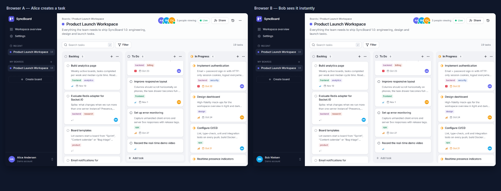
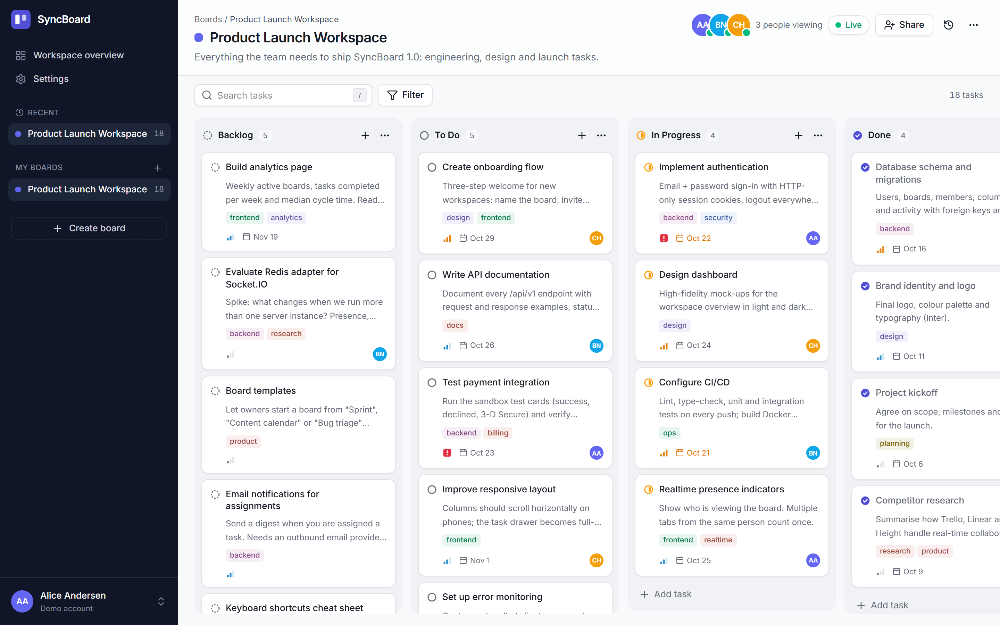
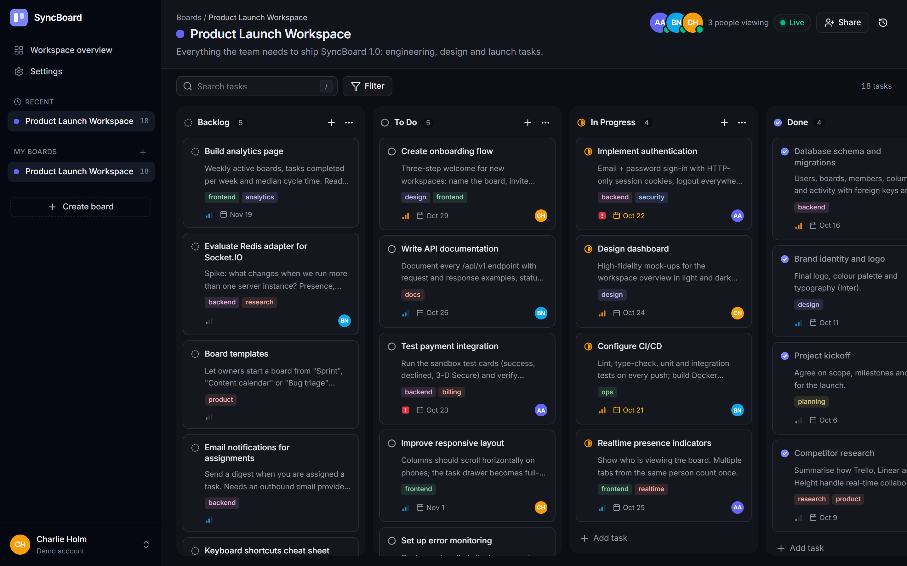
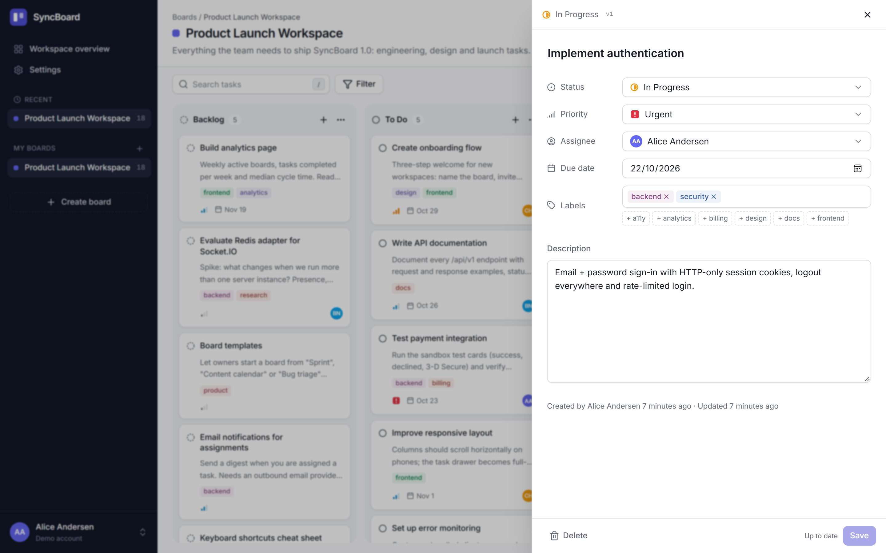
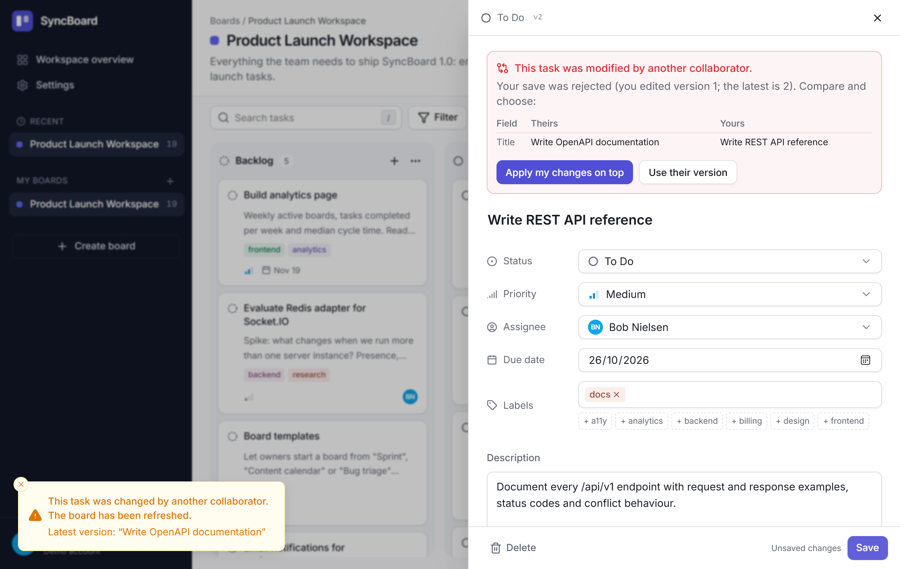
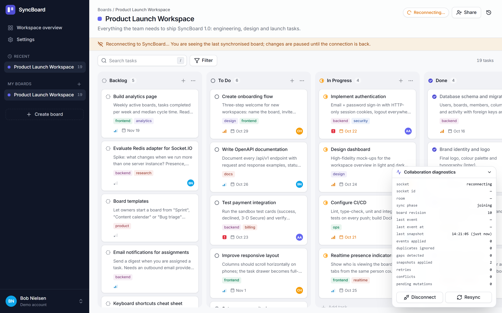
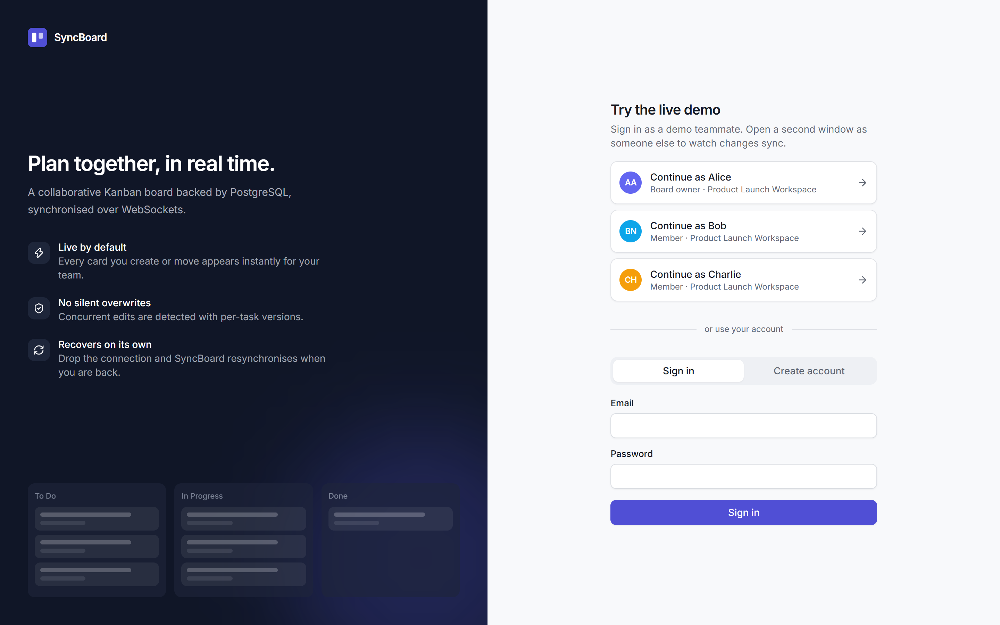
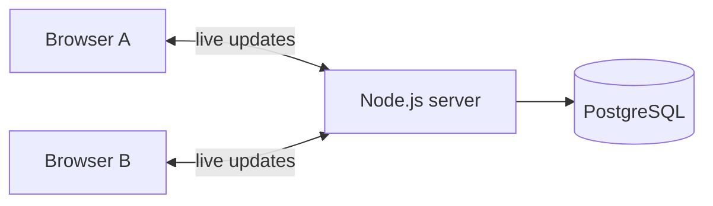

# SyncBoard

**A Kanban board that several people can edit at the same time, live.**

Open the same board in two browsers, move a card in one, and it moves in the other. Nobody's work
gets silently overwritten, and a browser that loses its connection catches up by itself.

**Built with** React · TypeScript · Socket.IO · Node.js · PostgreSQL · Docker · Playwright



---

## Contents

- [Try it](#try-it)
- [Features](#features)
- [Screenshots](#screenshots)
- [How it works](#how-it-works)
- [Tech stack](#tech-stack)
- [Tests](#tests)
- [Performance](#performance)
- [Limitations](#limitations)
- [Run it for development](#run-it-for-development)
- [Documentation](#documentation)

---

## Try it

You only need [Docker](https://www.docker.com/products/docker-desktop/).

```bash
git clone https://github.com/mariusgreiersen/syncboard-realtime.git
cd syncboard-realtime
cp .env.example .env
docker compose up --build
```

Then open **http://localhost:8080**.

### See the real-time collaboration

1. Open http://localhost:8080 in **two separate browser sessions** (for example a normal and a private window).
2. Click **Continue as Alice** in one and **Continue as Bob** in the other.
3. Open **Product Launch Workspace** in both. You will see "2 people viewing".
4. Drag a card or add a task in one window and watch it appear in the other.

A longer walkthrough (conflicts, disconnects, recording a demo video) is in [docs/demo.md](docs/demo.md).

> There is no public hosted version yet. The demo runs locally.

---

## Features

**Collaboration**
- Changes appear in every open browser instantly, without refreshing
- See who is on the board right now (one avatar per person, even with several tabs open)
- Connection status: *Live*, *Synchronizing*, *Reconnecting* or *Offline*
- If two people edit the same task, the second save is stopped and you can compare and choose
- After a lost connection, the board refreshes itself to the latest state

**Boards and tasks**
- Boards with owners and members; add people by email
- Columns: Backlog, To Do, In Progress, Done (add and rename your own)
- Tasks with title, description, priority, assignee, due date and labels
- Drag and drop, with keyboard and touch support
- Search and filters (assignee, priority, due date, column, labels)
- Activity feed: "Alice moved 'Implement authentication' to In Progress"

**Everything else**
- Accounts with secure login, plus one-click demo users (Alice, Bob, Charlie)
- Light and dark mode
- A developer panel that shows what the sync engine is doing

---

## Screenshots

| | |
|---|---|
| **Board**  | **Dark mode**  |
| **Task details**  | **Edit conflict**  |
| **Server down: reconnecting**  | **Sign in**  |

All screenshots are from the real running app (captured by [`scripts/screenshots.ts`](scripts/screenshots.ts)).
The "reconnecting" screen was produced by actually stopping the server.

---

## How it works



### 1. The database is the source of truth

Every change goes to the server, gets checked, and is saved in PostgreSQL. **Only after it is saved**
is it sent to the other browsers. Nothing important is kept only in memory.

### 2. Changes feel instant

When you drag a card, it moves on your screen right away while the server confirms in the
background. If the server rejects the change, your screen falls back to the latest saved board,
including everyone else's changes, and you see a short message explaining why.

### 3. No silent overwrites

Every task has a version number. When you save, the server checks that nobody changed the task since
you opened it. If someone did, your save is stopped and you can see both versions side by side:

> *This task was modified by another collaborator.* → **Apply my changes on top** or **Use their version**

When two people drag cards at the same moment, the server handles the moves one at a time, so every
browser ends up with the same order.

### 4. Recovering from lost connections

Every change on a board gets a number (1, 2, 3, …). If a browser notices it missed a number, or it
reconnects after being offline, it downloads a fresh copy of the board. While offline, the board stays
visible, but editing is paused so nothing pretends to be saved when it isn't.

Want the technical details? See [architecture](docs/architecture.md),
[synchronisation](docs/synchronization.md), [concurrency](docs/concurrency.md) and [security](docs/security.md).

---

## Tech stack

| Part | Technologies |
|---|---|
| Frontend | React 19, TypeScript, Vite, Tailwind CSS, shadcn/ui-style components (Radix), dnd-kit, TanStack Query, Zustand, React Hook Form, Zod |
| Backend | Node.js, Fastify, Socket.IO, Zod, Pino logging |
| Database | PostgreSQL 17, Drizzle ORM, SQL migrations |
| Testing | Vitest, React Testing Library, real Socket.IO clients, Playwright |
| Infrastructure | Docker, Docker Compose, nginx, GitHub Actions |

---

## Tests

| Suite | What it checks | Result |
|---|---|---|
| Unit and component | Validation, ordering logic, the client sync engine, UI components | ✅ 69 passed |
| Integration | REST API, permissions, conflicts, simultaneous edits, restarts (real PostgreSQL) | ✅ 63 passed (with realtime) |
| Realtime | Live updates, presence, reconnecting after a server restart (real sockets) | (included above) |
| End-to-end | Two real browsers: live collaboration, reconnection, conflict | ✅ 6 passed |

```bash
docker compose up -d postgres   # the tests need a database
npm install
npm test                        # unit + integration
npm run test:e2e                # browser tests (first run: npx playwright install chromium)
```

Results are from local runs on 20 October 2026 (Windows 10, Node 24). The
[GitHub Actions workflow](.github/workflows/ci.yml) is set up but has not run on GitHub yet.

---

## Performance

Measured on one machine (Intel i5-7600, 16 GB RAM) with [`scripts/benchmark.ts`](scripts/benchmark.ts):
one person makes 100 edits while other browsers listen.

| Listening browsers | Typical time until others see a change | Slowest 5 % | Messages delivered |
|---:|---:|---:|---:|
| 1 | 10.0 ms | 35.3 ms | 100 / 100 |
| 10 | 8.7 ms | 11.9 ms | 1,000 / 1,000 |
| 50 | 10.5 ms | 13.0 ms | 5,000 / 5,000 |

Everything ran on the same computer, so real internet latency is not included. This is not a load test.

---

## Limitations

- Runs as **one server**. Scaling to several servers would need extra pieces (listed in [architecture](docs/architecture.md#scaling-beyond-one-server-not-implemented)).
- **No offline editing**: changes are paused until the connection is back.
- Moving and editing the same card at the same moment counts as a conflict, even if different fields changed.
- No email invitations or password reset yet.

**Ideas for later:** comments, file attachments, notifications, live cursors, offline editing, multi-server support.

---

## Run it for development

Requires Node.js 22.12+ (developed and tested on Node 24) and Docker (for the database).

```bash
npm install
cp .env.example .env
docker compose up -d postgres
npm run db:migrate
npm run db:seed
npm run dev        # app on http://localhost:5173, API on http://localhost:3001
```

| Command | What it does |
|---|---|
| `npm run dev` | Start the API and the web app with hot reload |
| `npm test` | Unit and integration tests |
| `npm run test:e2e` | Two-browser Playwright tests |
| `npm run lint` · `npm run typecheck` | Code checks |
| `npm run build` | Production build |
| `npm run benchmark` | Latency benchmark (needs a running server) |

---

## Documentation

| Document | Contents |
|---|---|
| [Architecture](docs/architecture.md) | Components, request flow, database schema, trade-offs, deployment |
| [Synchronisation](docs/synchronization.md) | Live events, optimistic updates, reconnection |
| [Concurrency](docs/concurrency.md) | How simultaneous edits and drags stay consistent |
| [Security](docs/security.md) | Login, sessions, permissions, input validation |
| [API reference](docs/api.md) | All REST endpoints and error codes |
| [Demo guide](docs/demo.md) | Step-by-step demo and video recording tips |

---

## License

[MIT](LICENSE) © 2026 Marius Greiersen
