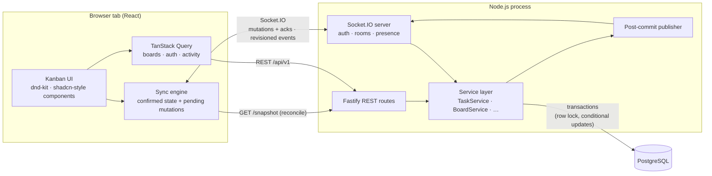
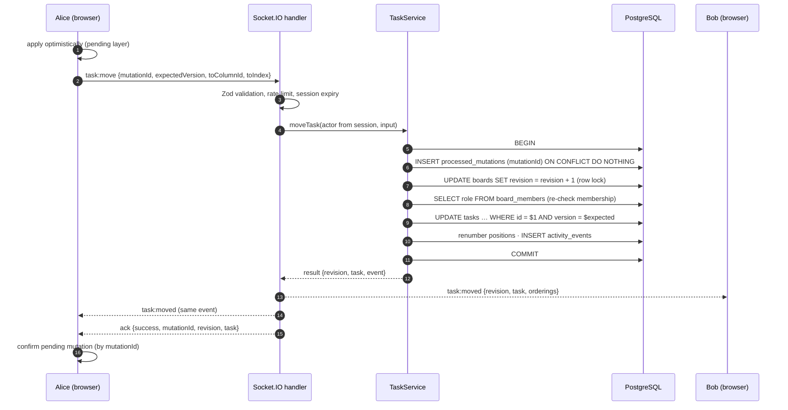
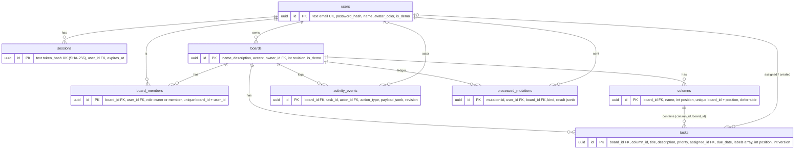

# Architecture

SyncBoard is a single-server, PostgreSQL-backed collaborative Kanban board. The design goal is
**correctness first**: the database is the only source of truth, every change is validated and
committed before anyone hears about it, and clients can always rebuild their view from an
authoritative snapshot.



## Responsibilities

| Layer | Responsibilities | Code |
|---|---|---|
| React client | Rendering, drag-and-drop, optimistic updates, reconciling server events, presence, connection state | `apps/client/src` |
| Sync engine (client, framework-free) | Ordered event intake, gap detection, snapshot reconciliation, mutation lifecycle (ack, timeout, retry, chaining) | `apps/client/src/sync` |
| REST API (Fastify) | Auth, boards, members, columns, tasks, snapshots, activity, health | `apps/server/src/api` |
| Socket.IO server | Cookie authentication, origin check, room joins (membership-checked), runtime payload validation, presence | `apps/server/src/realtime` |
| Service layer | Validation of business rules, authorisation inside the transaction, concurrency control, activity records, publishing after commit | `apps/server/src/modules` |
| PostgreSQL | Users, sessions, boards, members, columns, tasks, ordering, versions, activity, idempotency ledger | `apps/server/src/database/schema.ts`, `apps/server/drizzle/` |
| Shared package | Domain types, Zod schemas, typed Socket.IO contracts, ordering helpers | `packages/shared/src` |

**REST and Socket.IO call the same service methods.** `TaskService.moveTask()` is the only
implementation of a move; the transport layer only parses input and formats the result. A task
moved through `POST /api/v1/tasks/:id/move` is broadcast to Socket.IO clients exactly like one
moved by dragging a card.

## Request lifecycle of a mutation



The broadcast is emitted **after** `COMMIT` resolves. If the process crashes between commit and
broadcast, the change is durable but nobody was told; clients notice the missing revision on the
next event (or on reconnect) and fetch a snapshot. See [synchronization.md](synchronization.md).

## Project structure

```text
syncboard-realtime/
├── apps/
│   ├── client/                 React 19 + Vite + Tailwind 4
│   │   └── src/
│   │       ├── components/     ui/ (shadcn-style primitives) · layout/ · board/ · kanban/ · task/ · presence/
│   │       ├── pages/          Login · Overview · Board · Settings
│   │       ├── hooks/          useAuth · useBoardSync
│   │       ├── services/       REST client · Socket.IO singleton + connection store
│   │       ├── stores/         Zustand UI preferences
│   │       ├── sync/           engine.ts · controller.ts · boardSession.ts (+ tests)
│   │       └── lib/            filters · formatting · task metadata
│   └── server/                 Node.js + Fastify + Socket.IO + Drizzle ORM
│       ├── drizzle/            SQL migrations (generated + one hand-written)
│       └── src/
│           ├── api/            HTTP plumbing and routes
│           ├── auth/           password hashing, sessions, auth service
│           ├── database/       schema, client, migrate, seed
│           ├── modules/        boards · tasks · members · columns · activity · demo · mutations
│           ├── realtime/       socketServer · presence · rate limiter
│           ├── services/       service container
│           ├── app.ts          builds Fastify + Socket.IO (used by server.ts and tests)
│           └── server.ts       entry point with graceful shutdown
├── packages/shared/            types · schemas · events · ordering
├── tests/
│   ├── integration/            REST, concurrency, persistence (real PostgreSQL)
│   ├── realtime/               Socket.IO and reconnection (real sockets + real client engine)
│   ├── e2e/                    Playwright, multi-context
│   └── helpers/                test server harness, database setup
├── scripts/                    benchmark · screenshots · e2e server
├── docker/                     nginx.conf · server entrypoint
├── Dockerfile · docker-compose.yml · playwright.config.ts · vitest.config.ts
└── docs/
```

## Technology choices

| Choice | Why |
|---|---|
| **Fastify** | Fast, typed, first-class Pino logging and request ids. |
| **Drizzle ORM** | SQL-shaped API: conditional `UPDATE … WHERE version = $n RETURNING`, explicit transactions with isolation levels, raw SQL where needed (batch renumbering). Migrations are plain SQL files. |
| **Socket.IO** | Rooms, acknowledgements, automatic reconnection with backoff, WebSocket with HTTP long-polling fallback. |
| **Server-side sessions in PostgreSQL** | Revocable on logout (and the socket of that session is disconnected), no token in JavaScript-readable storage. |
| **scrypt** (Node `crypto`) | Memory-hard password hashing without a native addon. |
| **Zod 4 in a shared package** | One definition validates REST bodies, socket payloads and client forms. |
| **Integer positions + transactional renumbering** | Simple, deterministic, enforced by a database constraint; good enough for boards of hundreds of tasks. |

## Scaling beyond one server (not implemented)

The MVP intentionally runs **one** Node.js process. Durable state is already in PostgreSQL and
all correctness-critical coordination (board row lock, conditional updates, idempotency ledger)
happens in the database, so several API instances would not corrupt data. What would *not* work
with multiple instances today:

- **Broadcasts**: `io.to(room).emit` only reaches sockets on the same process → add the Socket.IO
  Redis (or Postgres) adapter, or an outbox table read by a relay.
- **Presence**: `PresenceTracker` is an in-memory map → move to Redis with per-socket keys and TTLs.
- **Event ordering across instances**: clients already reorder by revision and resync on gaps, so
  this part needs no change.
- **Load balancer**: sticky sessions are required for the HTTP long-polling transport (not for pure WebSocket).
- **Logout disconnect**: `disconnectSession` only sees local sockets → broadcast it through the adapter.

Multi-instance deployment is **not** claimed or tested.

## Database schema



- UUID primary keys everywhere; all timestamps are `timestamptz`; `ON DELETE CASCADE` from boards and
  users, `SET NULL` for assignee/creator/actor.
- CHECK constraints on positions, versions, revisions and title length.
- Migrations: [`apps/server/drizzle/`](../apps/server/drizzle). They are generated from
  [`schema.ts`](../apps/server/src/database/schema.ts), plus one hand-written migration for the deferrable
  constraints.

## Technical trade-offs

- **Single server.** Simpler and correct. Multi-instance needs a Socket.IO adapter, shared presence
  and a cross-instance logout broadcast (all listed, none claimed).
- **Per-board serialisation.** All writes to one board take its row lock. This gives deterministic
  ordering and contiguous revisions at the cost of per-board write concurrency, which is fine at
  human editing speed.
- **At-most-once events.** Socket.IO broadcasts can be lost (e.g. a crash after commit). Revisions
  make the loss detectable and snapshots repair it; an outbox would make delivery durable.
- **Snapshot reconciliation** costs one full-board read after reconnects and gaps. That is cheap for
  boards of hundreds of tasks.
- **PostgreSQL as the source of truth.** No task state lives in memory, so a restart loses only
  presence.
- **Optimistic concurrency** instead of locking tasks while someone edits. There is no blocking, and
  conflicts are rare and visible. Moves and edits of the same card conflict even if they touch
  different fields.
- **Integer positions** instead of fractional indexes: simple and dense, at the cost of renumbering
  siblings on each move.
- **Presence is ephemeral.** It is not persisted and is rebuilt as sockets rejoin.
- **No offline editing.** Editing is disabled while disconnected, rather than queued with
  conflict-prone replay.

## Deployment

The realtime server needs a host with long-lived WebSocket connections: a container platform or VM
(Fly.io, Render, Railway, a VPS), not a serverless HTTP function. For production:

- `COOKIE_SECURE=true` behind HTTPS (`wss://` follows automatically through the proxy),
- `ALLOWED_ORIGINS=https://your-domain`, `TRUST_PROXY=true` behind a reverse proxy,
- managed PostgreSQL via `DATABASE_URL`. Migrations run on container start (`dist/migrate.js`),
- a single instance (see above), `DEMO_RESET_INTERVAL_MINUTES` for a public demo,
- serve client and API from one origin (as the bundled nginx does) to keep cookies first-party.
