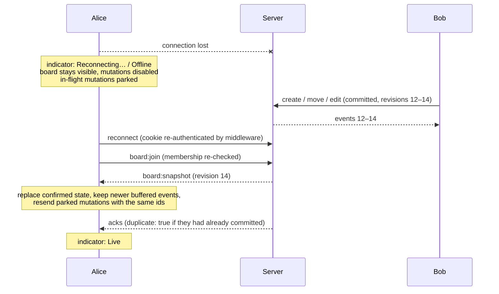

# Real-time synchronisation

This document explains how two browsers stay consistent: event contracts, revisions,
acknowledgements, optimistic UI, reconnection and what is (and is not) guaranteed.

## Rooms and contracts

Each board is a Socket.IO room named `board:<board-id>`. All event names and payloads are typed
in [`packages/shared/src/events.ts`](../packages/shared/src/events.ts) and validated at runtime
with Zod on the server.

| Direction | Event | Purpose |
|---|---|---|
| client → server | `board:join` (ack) | Membership check, join room, receive `board:snapshot` |
| client → server | `board:leave` (ack) | Leave room, update presence |
| client → server | `task:create` / `task:update` / `task:move` / `task:delete` (ack) | Mutations; each carries a `mutationId` |
| server → client | `board:snapshot` | Authoritative state after a join |
| server → client | `task:created` / `task:updated` / `task:moved` / `task:deleted` | Committed changes, each with a board `revision` |
| server → client | `presence:updated` | Who is viewing (ephemeral) |
| server → client | `board:sync-required` | Column/board/member changes, board reset, deletion or access revoked → fetch a snapshot |

Column, board-settings and member changes deliberately do not have their own fine-grained events;
they are rare, so they publish `board:sync-required` and clients refetch the snapshot.

## Revisions: one total order per board

`boards.revision` is incremented inside every mutation transaction by the same statement that
takes the board's row lock (see [concurrency.md](concurrency.md)). Because writers of one board are
serialised by that lock, revisions are **unique and contiguous** — the randomised concurrency test
asserts exactly this for 60 parallel requests.

Every event carries the revision it produced. The client engine
([`engine.ts`](../apps/client/src/sync/engine.ts)) therefore:

| Situation | Handling |
|---|---|
| `revision === confirmed + 1` | apply, then drain any buffered successors |
| `revision <= confirmed` | **duplicate or stale** → ignored (never overwrites newer data) |
| `revision > confirmed + 1` | buffer; if the gap is not filled within 1.5 s → fetch a snapshot |
| snapshot older than confirmed state | ignored (a slow response cannot roll the view back) |
| `board:sync-required` | fetch a snapshot; buffered later events are applied on top of it |

Socket.IO preserves message order on one connection, and the server emits after commit, so gaps
are rare in practice; the buffer exists because correctness must not depend on that.

## Acknowledgements and mutation ids

Every client mutation has a client-generated UUID `mutationId` and is emitted with a Socket.IO
acknowledgement and an 8-second timeout. The acknowledgement echoes the id:

```json
{ "success": true, "mutationId": "…", "revision": 42, "duplicate": false, "task": { "id": "…", "version": 4 }, "event": { "type": "task:moved", "revision": 42 } }
```

```json
{ "success": false, "mutationId": "…", "code": "VERSION_CONFLICT", "message": "This task was modified by another collaborator.", "currentVersion": 6, "currentTask": { } }
```

**A timeout does not mean failure.** The commit may have happened and only the ack was lost. The
client therefore retries with the **same** `mutationId` (up to 3 attempts). The server records each
mutation id in `processed_mutations` inside the mutation's own transaction; a repeated id returns the
stored result (`duplicate: true`) instead of executing again. If a retry races its original, the
second `INSERT` blocks on the uncommitted row and then sees the conflict — the integration tests
fire five identical requests concurrently and assert one execution.

The confirmation of a mutation can arrive as the broadcast event (which carries the same
`mutationId`) or as the ack, whichever is first; both paths are idempotent.

## Optimistic UI

The client keeps two layers ([`controller.ts`](../apps/client/src/sync/controller.ts)):

```text
displayed state = apply(pending mutations, confirmed state)
confirmed state = last snapshot + task events applied in revision order
```

- A drag immediately adds a `move` to the pending list; the card moves at once.
- When the server confirms, the pending entry is removed — the confirmed state now contains the
  same change, so nothing visibly changes.
- When the server **rejects** it (e.g. `VERSION_CONFLICT`), the pending entry is dropped and the view
  is recomputed from the confirmed state, which already includes every collaborator's committed
  changes. There is no "restore the old local copy" step that could erase someone else's work.
  The user sees *"This task was changed by another collaborator. The board has been refreshed."*
  and a snapshot is fetched.
- **Chaining**: if the user moves a card and then edits it before the move is confirmed, the edit
  waits and is sent with the version the server returned for the move. If the move is rejected, the
  edit is dropped too (it was based on it).
- Pending cards show a small "saving" indicator.

Optimism covers create, update, move/reorder and delete. Column and board changes are not
optimistic (they go through REST and a snapshot refresh).

## Disconnection and recovery



- Mutations are **disabled while disconnected**. SyncBoard does not offer offline editing; it never
  shows a change as saved that the server has not confirmed.
- Mutations that were in flight when the connection dropped are kept (visibly pending) and resent
  after the reconnect snapshot with their original ids, so they apply exactly once.
- Socket.IO's *connection state recovery* is **not enabled**. It can replay missed packets for short
  outages, but it restores room membership without re-running the authentication middleware by default
  and is not guaranteed. The snapshot path is always correct, so it is the only path.
- A server restart (deploy) looks like a dropped transport to clients: they reconnect automatically.
  The shutdown code closes transports rather than calling `disconnectSockets()`, because a
  server-initiated disconnect tells Socket.IO clients *not* to reconnect — a bug the restart test caught.

## Delivery guarantees (honest version)

- Socket.IO delivers each broadcast **at most once** per connected socket, in order per connection.
- A crash between `COMMIT` and the broadcast loses the notification, not the data. Clients converge
  on their next event (gap) or reconnect (snapshot). A transactional **outbox** would make delivery
  durable; it is listed under future work and not implemented.
- Presence is ephemeral and in-memory; it is rebuilt as sockets rejoin after a restart.

## How it is tested

- `apps/client/src/sync/*.test.ts` — engine and controller with a fake transport: ordering, duplicates,
  gaps, stale snapshots, chaining, rejections, ack timeouts with same-id retries, disconnect parking.
- `tests/realtime/reconnection.test.ts` — the real `BoardSession` + controller in Node against the
  real server: offline client converges after another client creates/moves/edits; a mutation in flight
  during a drop is applied exactly once; a full **server restart** with automatic reconnection.
  Each test compares both clients' views with the rows in PostgreSQL.
- `tests/e2e/collaboration.spec.ts` — the same scenarios in two real browser contexts.
